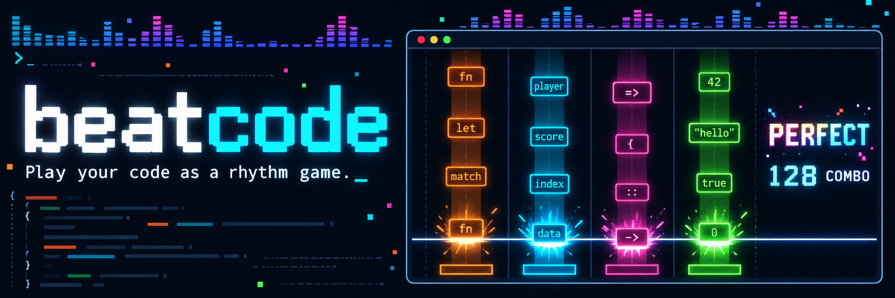

<p align="center">
  
</p>

<p align="center">
  <a href="README.md">English</a> · <b>日本語</b>
</p>

`beatcode` はターミナルで遊ぶ音ゲーです。落ちてくるノーツは本物のソースコードのトークンで、
種類ごと(キーワード・識別子・演算子・リテラル)の列を流れてきます。判定ラインで叩いて、
1 曲叩き切ると関数が 1 つ書き上がります。

<!-- TODO: デモ動画に差し替える -->
> 🎬 **デモ動画は準備中です。**

この repo には入れるためのスクリプトと、リリースのバイナリを置いています。ソースコードは公開していません。

## 入れ方

macOS 11 以降(Apple シリコン・Intel)と、Linux の x86_64 / arm64(glibc 2.35 以降。Ubuntu 22.04・Debian 12 以降)。Linux では音に ALSA(`libasound2`。たいていのデスクトップには入っています)、HTTPS に OpenSSL 3(`libssl3`)が要ります。インカメは macOS だけです。

**Homebrew**

```sh
brew tap yukihirop/beatcode https://github.com/yukihirop/beatcode
brew install beatcode
```

**npm**

```sh
npx beatcode            # 入れずに動かす
npm install -g beatcode # コマンドとして入れる
```

初めて動かしたときに、そのマシンに合うバイナリを GitHub Releases から落とし、SHA-256 を確かめて
`~/.cache/beatcode/npm/<版>/` に置きます。Node.js 18 以降。

**入れるスクリプト**

```sh
curl -fsSL https://raw.githubusercontent.com/yukihirop/beatcode/main/install.sh | sh
```

`~/.local/bin` に `beatcode` を置きます。置き場所は `BEATCODE_INSTALL_DIR`、版は `BEATCODE_VERSION=0.1.0` で選べます。

入ったかは `beatcode --version` で確かめられます。

## はじめ方

| | |
| --- | --- |
| **遊ぶ** | `beatcode`(曲選びの画面)か `beatcode path/to/file.rs` |
| **整える** | `beatcode skills` のあと、Claude Code か Codex で **`/beatcode-setup`** |
| **Spotify / YouTube Music / AI とつなぐ** | `beatcode setup` |
| **コマンドの一覧** | `beatcode --help` |

4 列のキーは既定で **D F J K**。**遊ぶ前に日本語入力を英数にしてください。**日本語入力のままだとキーがゲームに届きません。

- **どんなコードも譜面になります。**同梱の曲、手元の git repo、自分の GitHub の repo、
  その場で AI に書いてもらった譜面で遊べます。長いファイルは関数ごとに 1 つの譜面に切ります
- **6 つの言語。**Rust・Python・Go・TypeScript / JavaScript・Ruby・PHP(コメントはノーツになりません)。
  日本語と英語の文章(`.md` / `.txt`)も遊べます
- **Spotify の曲に合わせて。**お気に入りの曲を beatcode の中で流し、テンポとノーツの位置は
  曲の音を手元で解析して決めます。外へは何も送りません。YouTube Music(デスクトップアプリ Pear Desktop を操る)でも遊べます
- **4 / 6 / 8 列、NORMAL / HARD。**列を増やすとトークンの種類が細かく分かれます。
  HARD は同じコードを 16 分音符に詰め、同時押しと長押しが入ります
- **覚えています。**最後まで遊んだ回は履歴に残り、選べば同じ曲と譜面でもう一度遊べます

コンボの声(VOICEVOX / AivisSpeech)は `afplay` で鳴らします。

## プラグイン

ほかの言語(C・C#・CSS・HTML・JSON・Shell・TOML・YAML・Zig・中国語の文章)と AI の頼む先(Ollama・Google AI Studio)は
プラグインで足せます。beatcode と一緒に配っています。

```sh
beatcode plugins install        # 一覧
beatcode plugins install c zh   # C と中国語の文章を入れる
beatcode plugins uninstall c
beatcode plugins                # 読めたか確かめる
```

入れたものは `~/.local/share/beatcode/plugins/` に置きます。

## やめ方

Claude Code か Codex で `/beatcode-teardown` を打つと、beatcode が置いた設定・履歴・キャッシュ
(`~/.config/beatcode/`・`~/.cache/beatcode/`)と入れたプラグイン(`~/.local/share/beatcode/`)を片付けます。そのあと、入れた方法に合わせてコマンドを消します。

| 入れた方法 | 消し方 |
| --- | --- |
| Homebrew | `brew uninstall beatcode && brew untap yukihirop/beatcode` |
| npm | `npm uninstall -g beatcode`(落としたバイナリは `~/.cache/beatcode/npm/` にあります) |
| 入れるスクリプト | `rm ~/.local/bin/beatcode` |

---

## ライセンス

`beatcode` は著作権者がすべての権利を持つソフトウェアです。公式の配布元(この repo の Releases・Homebrew の formula・
npm の `beatcode`・`beatcode plugins install`)から入れたバイナリを、個人が非商用で動かすことだけ許可しています。
再配布・公開・共有・販売・サブライセンス・改変・リバースエンジニアリング、製品やホスティングサービスへの組み込みは禁止です。
詳しい条件は [LICENSE](LICENSE) を確認してください。
