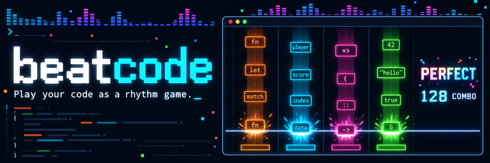

<p align="center">
  
</p>

<p align="center">
  <b>English</b> · <a href="README.ja.md">日本語</a>
</p>

`beatcode` is a rhythm game for the terminal. The notes are the tokens of real source code. They fall
down lanes by kind (keyword, identifier, operator, literal), and you hit them on the judgment line.
Finish a song and you have typed out a function.

https://github.com/user-attachments/assets/5e694914-460f-4a3f-a2e9-caf85bf29777

<p align="center"><sub>30 seconds with sound: シャイニングスター (Shining Star, ♩=158) on the bundled Rust charts. A small bot that reads the screen did the hitting. Music: <a href="https://maou.audio/">魔王魂</a></sub></p>

This repository holds the install scripts and release binaries. The source code is not public.

## Install

macOS 11 or later (Apple silicon or Intel), or Linux on x86_64 / arm64 with glibc 2.35 or later (Ubuntu 22.04, Debian 12 or newer). On Linux, sound needs ALSA (`libasound2`, present on most desktops) and HTTPS needs OpenSSL 3 (`libssl3`). The front camera panel is macOS only.

**Homebrew**

```sh
brew tap yukihirop/beatcode https://github.com/yukihirop/beatcode
brew install beatcode
```

**npm**

```sh
npx beatcode            # run without installing
npm install -g beatcode # or install the command
```

The first run downloads the binary for your machine from GitHub Releases, checks its SHA-256, and keeps it
in `~/.cache/beatcode/npm/<version>/`. Node.js 18 or later.

**Install script**

```sh
curl -fsSL https://beatcode.run/install.sh | sh
```

It puts `beatcode` in `~/.local/bin`. Set `BEATCODE_INSTALL_DIR` to put it somewhere else, or
`BEATCODE_VERSION=0.1.0` to pick a version.

Check with `beatcode --version`.

## Get started

| | |
| --- | --- |
| **Play** | `beatcode` (song select) or `beatcode path/to/file.rs` |
| **Set up** | `beatcode skills`, then **`/beatcode-setup`** in Claude Code or Codex |
| **Connect Spotify / YouTube Music / AI** | `beatcode setup` |
| **See every command** | `beatcode --help` |

Default keys are **D F J K** for the four lanes. Switch your input method to plain ASCII before you play:
with a Japanese IME on, the keys never reach the game.

- **Any code is a chart.** Play the bundled songs, the git repos on your machine, your own GitHub repos,
  or a chart an AI writes for you on the spot. Long files are cut into one chart per function
- **Seven languages.** Rust, Python, Go, TypeScript, JavaScript, Ruby and PHP (comments are not notes).
  Plain text works too: Japanese and English `.md` / `.txt`
- **Play along to Spotify.** Your liked songs play inside beatcode, and the tempo and note positions come
  from analyzing the song's audio on your machine. Nothing is sent anywhere. YouTube Music works too (by driving the Pear Desktop app)
- **4, 6 or 8 lanes, NORMAL or HARD.** More lanes split tokens into finer kinds. HARD packs the same code
  into 16th notes, with chords and hold notes
- **It remembers.** Every finished play goes to your history; pick one to play the same song and chart again

The combo voice (VOICEVOX / AivisSpeech) plays through `afplay`.

## Plugins

More languages (C, C#, CSS, HTML, JSON, Shell, TOML, YAML, Zig, Chinese prose) and AI providers (Ollama, Google AI Studio)
come as plugins, released together with beatcode:

```sh
beatcode plugins install        # list them
beatcode plugins install c zh   # install C and Chinese prose
beatcode plugins uninstall c
beatcode plugins                # check what is loaded
```

They go to `~/.local/share/beatcode/plugins/`.

## Uninstall

`/beatcode-teardown` in Claude Code or Codex removes the settings, history and caches beatcode keeps
(`~/.config/beatcode/`, `~/.cache/beatcode/`) and the plugins (`~/.local/share/beatcode/`). Then remove the command the way you installed it:

| Installed with | Remove with |
| --- | --- |
| Homebrew | `brew uninstall beatcode && brew untap yukihirop/beatcode` |
| npm | `npm uninstall -g beatcode` (the downloaded binary is in `~/.cache/beatcode/npm/`) |
| Install script | `rm ~/.local/bin/beatcode` |

---

## License

`beatcode` is proprietary software. All rights are reserved. You may install and run the
official binaries (from the Releases of yukihirop/beatcode, its Homebrew formula,
the npm package `beatcode`, or `beatcode plugins install`) for personal,
non-commercial use. Redistributing, publishing, sharing, selling, sublicensing,
modifying, reverse engineering, or providing it as part of a product or hosted
service is not permitted. See [LICENSE](LICENSE) for the complete terms.
